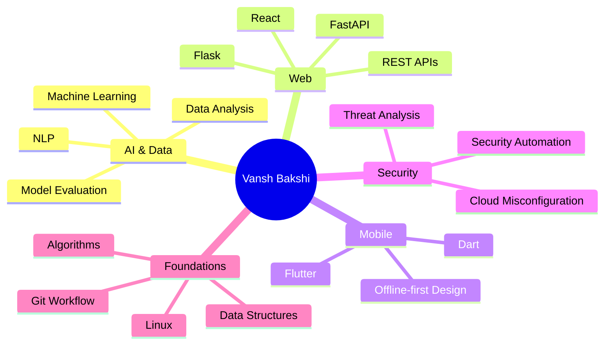
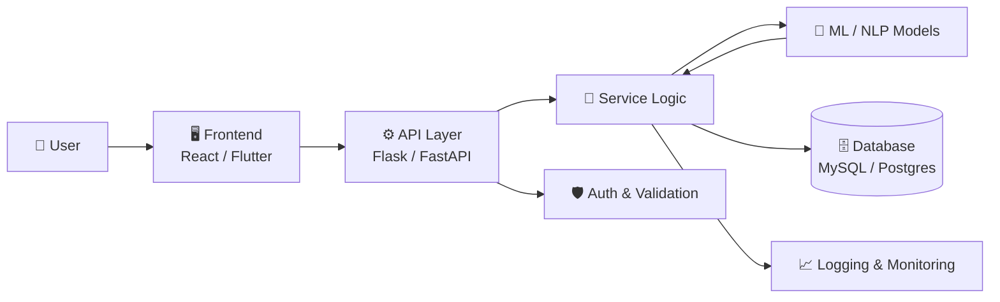
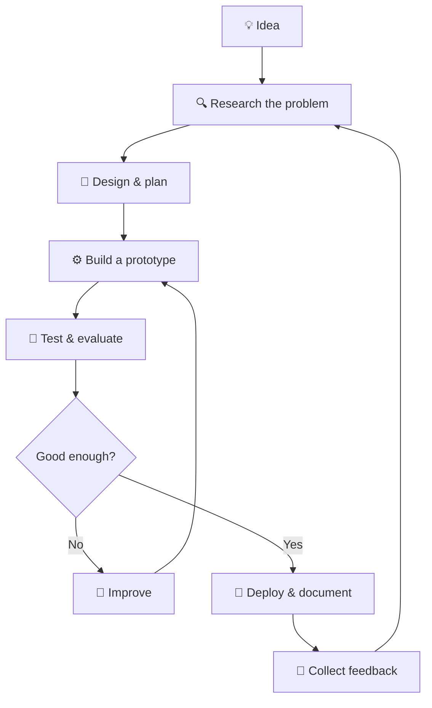
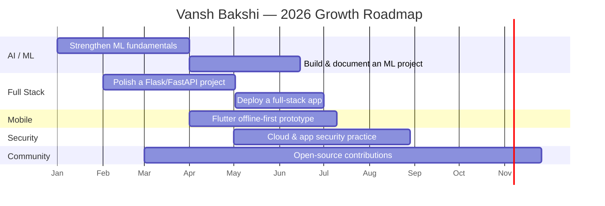
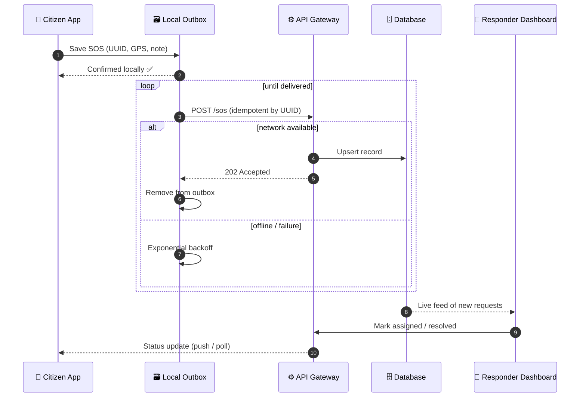
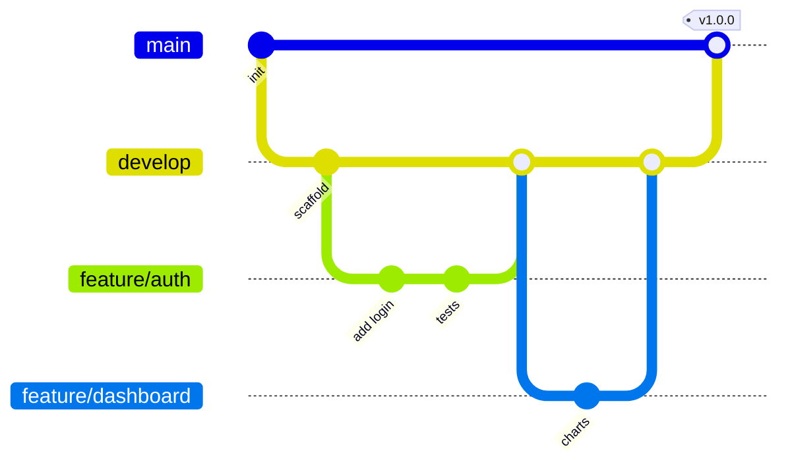
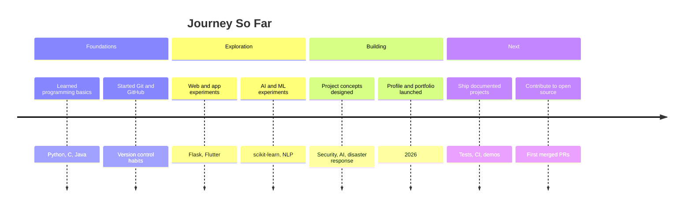

<!--
╔══════════════════════════════════════════════════════════════════════╗
║  V A N S H   B A K S H I   //   U L T I M A T E   E D I T I O N  v2  ║
║  CYBERPUNK • ARTIFICIAL INTELLIGENCE • FULL STACK • CYBERSECURITY    ║
╚══════════════════════════════════════════════════════════════════════╝
 Tip: search this file for "TODO" to find the spots you should personalise.
-->

<div align="center">


<br/>


<br/><br/>

[](https://github.com/VanshBakshi)
[](https://vanshbakshi.github.io/)
[](mailto:vanshbakshi62@gmail.com)

<br/>


**`01010100 01001000 01000101 00100000 01000110 01010101 01010100 01010101 01010010 01000101`**

*Not just writing code. Engineering possibilities.*

</div>

---

## 🧭 `00 // NAVIGATION MATRIX`

<div align="center">

| | | | |
|:--:|:--:|:--:|:--:|
| [🌌 About](#-01--welcome-to-the-cyber-universe) | [🤖 Tech Stack](#-02--the-technology-reactor) | [🛸 Projects](#-03--projects-from-the-digital-frontier) | [🏛️ Architecture](#️-04--system-architecture-thinking) |
| [📊 Telemetry](#-05--developer-telemetry) | [🐍 Contributions](#-06--the-contribution-matrix) | [🧪 Mindset](#-07--the-engineering-mindset) | [🗺️ Roadmap](#️-08--roadmap-2026) |
| [📚 Learning Log](#-09--learning-log) | [🎯 Focus Areas](#-10--current-focus) | [📡 Live Dashboard](#-11--live-dashboard) | [💻 Code Showcase](#-12--code-showcase) |
| [🔬 Case Study](#-13--case-study-jeevansetu) | [🛡️ Quality & Security](#️-14--quality--security-practices) | [📡 Tech Radar](#-15--tech-radar--achievements) | [🏆 Milestones](#-16--milestones--recommendations) |
| [❓ FAQ](#-17--faq) | [🌐 Contact](#-18--establish-connection) | | |

</div>

---

# 🌌 `01 // WELCOME TO THE CYBER UNIVERSE`

<table>
<tr>
<td width="60%" valign="top">

## 👨‍🚀 WHO AM I?

Hey there! I'm **Vansh Bakshi** — a technology enthusiast exploring the intersection of software engineering, artificial intelligence, automation, cybersecurity, and creative problem-solving.

I enjoy turning ideas into useful digital experiences, experimenting with new technologies, and building projects that address real-world challenges. I believe in learning in public, documenting what I build, and improving with every iteration.

```python
from dataclasses import dataclass, field
from typing import List


@dataclass
class VanshBakshi:
    name: str = "Vansh Bakshi"
    role: str = "Developer & Tech Enthusiast"
    base: str = "India 🇮🇳"
    interests: List[str] = field(default_factory=lambda: [
        "Artificial Intelligence",
        "Machine Learning",
        "Full Stack Development",
        "Python Engineering",
        "Flutter Applications",
        "Cybersecurity",
        "Intelligent Automation",
    ])
    principles: List[str] = field(default_factory=lambda: [
        "Understand the problem first",
        "Ship small, iterate fast",
        "Document everything",
        "Never stop learning",
    ])
    mission: str = "Build. Improve. Innovate."

    def next_evolution(self) -> str:
        return "Turning ideas into reality 🚀"


if __name__ == "__main__":
    print(VanshBakshi().next_evolution())
```

</td>
<td width="40%" align="center" valign="middle">


<br/><br/>


<br/><br/>

<br/><br/>


</td>
</tr>
</table>

<div align="center">

### 🧬 MY DEVELOPER DNA

`CURIOSITY` ➜ `LEARNING` ➜ `EXPERIMENTATION` ➜ `ENGINEERING` ➜ `INNOVATION`

</div>

### ⚡ Quick Facts

| 🔹 | |
|:--|:--|
| 🔭 **Currently exploring** | AI/ML applications, secure software, cross-platform apps |
| 🌱 **Currently learning** | Advanced Python, system design, ML model evaluation |
| 👯 **Open to collaborate on** | Open-source, AI tooling, hackathon-style projects |
| 💬 **Ask me about** | Python, Flutter, Flask, ML basics, project ideas |
| 📫 **Reach me** | [vanshbakshi62@gmail.com](mailto:vanshbakshi62@gmail.com) |
| ⚡ **Fun fact** | I try to turn every idea into a prototype, however small |

---

# 🤖 `02 // THE TECHNOLOGY REACTOR`

<div align="center">

### ⚡ PROGRAMMING LANGUAGES


### 🌐 WEB ENGINEERING


### 📱 APP DEVELOPMENT


### 🧠 ARTIFICIAL INTELLIGENCE & DATA


### 🛡️ SECURITY & NETWORKING


### 🛠️ DEVELOPMENT INFRASTRUCTURE


</div>

> **Note:** These icons represent technologies in my learning and development toolkit. My actual proficiency varies by technology.

### 📈 Skill Focus Map



### 🧰 Proficiency Legend

| Level | Meaning |
|:--|:--|
| 🟢 **Comfortable** | Used in projects and can work independently |
| 🟡 **Building** | Actively practising through projects and coursework |
| 🔵 **Exploring** | Learning fundamentals and running experiments |

> **TODO:** Move each technology into the level that honestly matches you. Recruiters value accurate self-assessment more than a long icon wall.

| Area | Technologies | Level |
|:--|:--|:--:|
| Languages | Python | 🟢 / 🟡 *(TODO)* |
| Languages | Java, C, C++, JavaScript | 🟡 *(TODO)* |
| Web | Flask, HTML, CSS, React | 🟡 *(TODO)* |
| Mobile | Flutter, Dart | 🟡 *(TODO)* |
| ML | scikit-learn, pandas, TensorFlow, PyTorch | 🔵 *(TODO)* |
| Security | Linux, networking basics, security analytics | 🔵 *(TODO)* |
| Tools | Git, GitHub, Docker, VS Code | 🟡 *(TODO)* |

---

# 🛸 `03 // PROJECTS FROM THE DIGITAL FRONTIER`

<div align="center">


</div>

<div align="center">

| Project | Domain | Stack | Status |
|:--|:--|:--|:--:|
| 🛡️ CyberSentinel AI | AI Security | Python · Flask | 🧪 Concept / Prototype |
| 🧠 ResumeCheck AI | NLP / Career Tech | Python · NLP | 🧪 Concept / Prototype |
| 🎧 SupportOps AI | Automation | Python · APIs · NLP | 🧪 Concept / Prototype |
| 🚨 JeevanSetu | Disaster Response | Flutter · Python | 🧪 Concept / Prototype |
| 💳 Fraud Detection AI | Machine Learning | Python · scikit-learn | 🧪 Concept / Prototype |
| ☁️ CloudMisconfig AI | Cloud Security | Python · APIs | 🧪 Concept / Prototype |

<sub>**TODO:** update the Status column to ✅ Complete / 🚧 In Progress / 🧪 Prototype per project, and link each to its repo.</sub>

</div>

<br/>

<table>
<tr>
<td width="50%" valign="top">

## 🛡️ CyberSentinel AI


**Mission:** Explore intelligent security monitoring and threat analysis.

**Problem:** Security teams face large volumes of events and alerts, making it hard to spot what matters.

**Potential features**

* Security-event analysis
* Suspicious activity insights
* Monitoring dashboards
* Automated security reports

**Technology direction:** Python · Flask · Security Analytics

[**Explore my repositories →**](https://github.com/VanshBakshi?tab=repositories)

</td>
<td width="50%" valign="top">

## 🧠 ResumeCheck AI


**Mission:** Help candidates understand how their resumes match job descriptions.

**Problem:** Candidates rarely know why a resume is or isn't a fit for a role.

**Potential features**

* Resume text extraction
* Job-description comparison
* Skill-gap analysis
* Improvement recommendations

**Technology direction:** Python · NLP · Document Processing

[**Explore my repositories →**](https://github.com/VanshBakshi?tab=repositories)

</td>
</tr>
<tr>
<td width="50%" valign="top">

## 🎧 SupportOps AI


**Mission:** Explore smarter customer-support workflows.

**Problem:** Support queues grow faster than teams can triage them.

**Potential features**

* Ticket categorization
* Priority recommendations
* Suggested troubleshooting steps
* SLA-risk indicators

**Technology direction:** Python · APIs · NLP · Automation

[**Explore my repositories →**](https://github.com/VanshBakshi?tab=repositories)

</td>
<td width="50%" valign="top">

## 🚨 JeevanSetu


**Mission:** Explore digital coordination for disaster response.

**Problem:** During disasters, connectivity is unreliable and information is scattered.

**Potential features**

* Emergency SOS workflows
* Rescue coordination
* Shelter information
* Offline-first mobile experience

**Technology direction:** Flutter · Python · Data Systems

[**Explore my repositories →**](https://github.com/VanshBakshi?tab=repositories)

</td>
</tr>
<tr>
<td width="50%" valign="top">

## 💳 Fraud Detection AI


**Mission:** Investigate machine-learning techniques for identifying potentially fraudulent transactions.

**Problem:** Fraud is rare, so naive models look accurate while missing real cases.

**Exploration areas**

* Class imbalance
* Feature engineering
* Model evaluation
* Precision and recall

**Technology direction:** Python · pandas · scikit-learn

[**Explore my repositories →**](https://github.com/VanshBakshi?tab=repositories)

</td>
<td width="50%" valign="top">

## ☁️ CloudMisconfig AI


**Mission:** Explore ways to detect and explain potentially risky cloud configurations.

**Problem:** Small configuration mistakes often cause the largest cloud security incidents.

**Potential features**

* Configuration checks
* Risk classification
* Findings dashboard
* Remediation guidance

**Technology direction:** Python · Cloud Security · APIs

[**Explore my repositories →**](https://github.com/VanshBakshi?tab=repositories)

</td>
</tr>
</table>

<div align="center">

### ⚠️ PROJECT TRANSPARENCY

These cards describe project concepts and areas of development, not a claim that every feature is complete. Visit my repositories to see the code, implementation status, and available documentation.

</div>

### 🧱 Project Standard (my definition of "done")

```yaml
definition_of_done:
  code:
    - readable, modular, typed where possible
    - linted and formatted
  quality:
    - unit tests for core logic
    - README with setup, usage, screenshots
  delivery:
    - reproducible install (requirements / Docker)
    - tagged release and changelog
  security:
    - no secrets in the repo
    - dependencies reviewed
```

---

# 🏛️ `04 // SYSTEM ARCHITECTURE THINKING`

How I approach designing an AI-powered application end to end:



### 🔄 My Development Lifecycle



### 🧠 Example: Minimal ML Evaluation Pipeline

A small illustration of the kind of work behind **Fraud Detection AI** (class imbalance + precision/recall):

```python
import pandas as pd
from sklearn.ensemble import RandomForestClassifier
from sklearn.metrics import classification_report
from sklearn.model_selection import train_test_split


def evaluate(df: pd.DataFrame, target: str = "is_fraud") -> str:
    """Train a baseline model and report precision/recall per class."""
    X, y = df.drop(columns=[target]), df[target]

    X_train, X_test, y_train, y_test = train_test_split(
        X, y, test_size=0.2, stratify=y, random_state=42
    )

    model = RandomForestClassifier(
        n_estimators=200,
        class_weight="balanced",  # handle class imbalance
        n_jobs=-1,
        random_state=42,
    )
    model.fit(X_train, y_train)

    return classification_report(y_test, model.predict(X_test))
```

> Accuracy alone is misleading on imbalanced data, so I focus on **precision, recall, and F1** instead.

---

# 📊 `05 // DEVELOPER TELEMETRY`

<div align="center">


<br/><br/>


<br/><br/>


<br/><br/>


</div>

---

# 🐍 `06 // THE CONTRIBUTION MATRIX`

<div align="center">


**Every contribution is another step forward.**

<sub>This animation requires a GitHub Actions workflow to generate and publish the SVG — see the setup below.</sub>

</div>

<details>
<summary><b>⚙️ Click to see the snake workflow (.github/workflows/snake.yml)</b></summary>

```yaml
name: Generate Snake Animation

on:
  schedule:
    - cron: "0 */12 * * *"   # every 12 hours
  workflow_dispatch:
  push:
    branches: [main]

permissions:
  contents: write

jobs:
  generate:
    runs-on: ubuntu-latest
    steps:
      - uses: Platane/snk/svg-only@v3
        with:
          github_user_name: ${{ github.repository_owner }}
          outputs: |
            dist/github-contribution-grid-snake-dark.svg?palette=github-dark
            dist/github-contribution-grid-snake.svg

      - uses: crazy-max/ghaction-github-pages@v3.1.0
        with:
          target_branch: output
          build_dir: dist
        env:
          GITHUB_TOKEN: ${{ secrets.GITHUB_TOKEN }}
```

</details>

---

# 🧪 `07 // THE ENGINEERING MINDSET`

<table>
<tr>
<td width="33%" align="center">

### 🔍 ANALYZE

Understand the problem before choosing the solution.

</td>
<td width="33%" align="center">

### ⚙️ ENGINEER

Build, test, improve, and document the solution.

</td>
<td width="33%" align="center">

### 🚀 EVOLVE

Learn from feedback and make the next version better.

</td>
</tr>
</table>

<div align="center">

```text
┌────────────────────────────────────────────────────┐
│                 VANSH DEVELOPMENT OS               │
├────────────────────────────────────────────────────┤
│  LEARNING       [ ACTIVE ]                         │
│  EXPERIMENTING  [ ACTIVE ]                         │
│  BUILDING       [ ACTIVE ]                         │
│  IMPROVING      [ ALWAYS ]                         │
├────────────────────────────────────────────────────┤
│  PRIMARY DIRECTIVE: SOLVE REAL PROBLEMS            │
└────────────────────────────────────────────────────┘
```

</div>

### 📜 Engineering Principles

1. **Clarity over cleverness** — code is read far more often than it is written.
2. **Small, working increments** — a running prototype beats a perfect plan.
3. **Measure, don't guess** — evaluate models and performance with data.
4. **Secure by default** — validate input, protect secrets, least privilege.
5. **Document as you go** — future me (and collaborators) will say thanks.

---

# 🗺️ `08 // ROADMAP 2026`

<div align="center">



<sub>TODO: adjust dates and goals to match your real plan.</sub>

</div>

| MISSION | OBJECTIVE |
|:--|:--|
| 🧠 AI Engineering | Build useful AI/ML applications |
| 🌐 Full Stack | Develop complete web experiences |
| 📱 Mobile Systems | Build cross-platform applications |
| 🛡️ Cybersecurity | Explore security analysis and automation |
| 🧩 Problem Solving | Strengthen algorithms and coding skills |
| 🏗️ Real-World Projects | Ship documented, working software |
| 🤝 Open Source | Learn through collaboration and contributions |

### ✅ Checklist

- [x] Create a profile README
- [ ] Ship at least one project end to end with tests and docs
- [ ] Deploy a live demo and link it from the portfolio
- [ ] Make first open-source pull request
- [ ] Publish a technical write-up or blog post
- [ ] Earn a relevant certification *(TODO: choose one)*

---

# 📚 `09 // LEARNING LOG`

<div align="center">

| Domain | Topic | Resource / Method | Progress |
|:--|:--|:--|:--:|
| 🐍 Python | Clean code, typing, testing | Practice projects | ▰▰▰▰▱ |
| 🧠 ML | Evaluation, imbalance, feature engineering | Notebooks | ▰▰▰▱▱ |
| 🌐 Web | REST design, auth, deployment | Flask / FastAPI apps | ▰▰▰▱▱ |
| 📱 Mobile | State management, offline storage | Flutter prototypes | ▰▰▱▱▱ |
| 🛡️ Security | OWASP Top 10, cloud misconfiguration | Labs & reading | ▰▰▱▱▱ |
| 🧮 DSA | Arrays, trees, graphs, DP | Daily practice | ▰▰▰▱▱ |

<sub>TODO: update the bars honestly as you progress.</sub>

</div>

### 🧠 Daily Routine Algorithm

```python
def daily_routine(day: int) -> list[str]:
    tasks = ["Solve 1-2 problems", "Read or watch 30 min of something new"]
    if day % 2 == 0:
        tasks.append("Work on a personal project")
    if day % 7 == 0:
        tasks += ["Review the week", "Write notes / documentation"]
    return tasks
```

---

# 🎯 `10 // CURRENT FOCUS`

<div align="center">

| | |
|:--:|:--|
| 🔭 | Turning project concepts into **working, documented repositories** |
| 🧠 | Deepening **machine-learning evaluation** skills |
| 🌐 | Building a **deployable full-stack** application |
| 🛡️ | Practising **secure coding** habits |
| 🤝 | Finding **open-source** projects to contribute to |

</div>

### 🏷️ Collaboration Interests

<div align="center">


</div>

---

# 📡 `11 // LIVE DASHBOARD`

<div align="center">


</div>

### 🆕 Recently Active Repositories

> This table is rewritten automatically by a scheduled GitHub Action (see `scripts/update_readme.py`). It always shows what I'm *actually* working on.

<!-- REPOS:START -->
| Repository | Language | Updated |
|:--|:--|:--|
| *Auto-generated after the first workflow run* | — | — |
<!-- REPOS:END -->

### 🧭 Profile Summary Cards

<div align="center">


</div>

### 💬 Dev Wisdom

<div align="center">


</div>

---

# 💻 `12 // CODE SHOWCASE`

> **Honest note:** these are *illustrative, self-contained snippets* showing how I approach the problems behind my project ideas. They are not copied from a finished product.

<details open>
<summary><b>🧠 ResumeCheck AI — job-match scoring + skill-gap analysis (Python)</b></summary>

```python
from __future__ import annotations

import re
from dataclasses import dataclass

from sklearn.feature_extraction.text import TfidfVectorizer
from sklearn.metrics.pairwise import cosine_similarity

TOKEN = re.compile(r"[a-zA-Z][a-zA-Z+#.\-]{1,}")


@dataclass(frozen=True)
class MatchReport:
    score: float                 # 0-100
    matched_skills: list[str]
    missing_skills: list[str]


def _tokens(text: str) -> set[str]:
    return {t.lower() for t in TOKEN.findall(text)}


def analyze(resume: str, job_description: str, skills: set[str]) -> MatchReport:
    """Compare a resume to a job description using TF-IDF similarity
    plus an explicit skill-gap check against a curated skills vocabulary."""
    vec = TfidfVectorizer(stop_words="english", ngram_range=(1, 2))
    matrix = vec.fit_transform([resume, job_description])
    similarity = float(cosine_similarity(matrix[0], matrix[1])[0, 0])

    required = _tokens(job_description) & skills
    have = _tokens(resume) & skills

    return MatchReport(
        score=round(similarity * 100, 1),
        matched_skills=sorted(required & have),
        missing_skills=sorted(required - have),
    )
```

</details>

<details>
<summary><b>☁️ CloudMisconfig AI — explainable rule engine (Python)</b></summary>

```python
from __future__ import annotations

from dataclasses import dataclass
from enum import IntEnum
from typing import Callable, Iterable


class Severity(IntEnum):
    LOW = 1
    MEDIUM = 2
    HIGH = 3
    CRITICAL = 4


@dataclass(frozen=True)
class Rule:
    id: str
    severity: Severity
    title: str
    remediation: str
    check: Callable[[dict], bool]    # True => misconfiguration found


@dataclass(frozen=True)
class Finding:
    rule_id: str
    severity: Severity
    resource: str
    title: str
    remediation: str


RULES: tuple[Rule, ...] = (
    Rule("STO-001", Severity.CRITICAL, "Storage bucket is publicly readable",
         "Disable public access and use scoped, signed URLs.",
         lambda r: r.get("type") == "bucket" and r.get("public", False)),
    Rule("STO-002", Severity.HIGH, "Storage encryption at rest is disabled",
         "Enable server-side encryption with a managed key.",
         lambda r: r.get("type") == "bucket" and not r.get("encrypted", True)),
    Rule("NET-001", Severity.HIGH, "SSH open to the entire internet",
         "Restrict port 22 to a trusted CIDR or use a bastion/SSM.",
         lambda r: r.get("type") == "firewall"
         and "0.0.0.0/0" in r.get("ssh_sources", [])),
)


def scan(resources: Iterable[dict]) -> list[Finding]:
    findings = [
        Finding(rule.id, rule.severity, res.get("name", "unknown"),
                rule.title, rule.remediation)
        for res in resources
        for rule in RULES
        if rule.check(res)
    ]
    return sorted(findings, key=lambda f: f.severity, reverse=True)


if __name__ == "__main__":
    demo = [
        {"type": "bucket", "name": "logs-prod", "public": True, "encrypted": False},
        {"type": "firewall", "name": "web-sg", "ssh_sources": ["0.0.0.0/0"]},
    ]
    for f in scan(demo):
        print(f"[{f.severity.name:<8}] {f.rule_id} {f.resource}: {f.title}\n   ↳ {f.remediation}")
```

</details>

<details>
<summary><b>🛡️ CyberSentinel AI — hardened Flask API with validation + rate limiting</b></summary>

```python
from __future__ import annotations

import logging
from collections import Counter

from flask import Flask, jsonify, request
from flask_limiter import Limiter
from flask_limiter.util import get_remote_address

app = Flask(__name__)
app.config["MAX_CONTENT_LENGTH"] = 256 * 1024          # reject oversized bodies
limiter = Limiter(get_remote_address, app=app, default_limits=["60/minute"])
logging.basicConfig(level=logging.INFO, format="%(asctime)s %(levelname)s %(message)s")

ALLOWED_LEVELS = {"info", "warning", "error", "critical"}


def validate(event: object) -> str | None:
    if not isinstance(event, dict):
        return "event must be an object"
    if event.get("level") not in ALLOWED_LEVELS:
        return f"level must be one of {sorted(ALLOWED_LEVELS)}"
    if not isinstance(event.get("source"), str) or not 0 < len(event["source"]) <= 128:
        return "source must be a non-empty string (<=128 chars)"
    return None


@app.post("/api/v1/events")
@limiter.limit("20/minute")
def ingest():
    payload = request.get_json(silent=True)
    events = payload.get("events") if isinstance(payload, dict) else None
    if not isinstance(events, list) or not 0 < len(events) <= 500:
        return jsonify(error="events must be a list of 1-500 items"), 400

    for i, ev in enumerate(events):
        if (err := validate(ev)):
            return jsonify(error=f"events[{i}]: {err}"), 422

    summary = Counter(ev["level"] for ev in events)
    app.logger.info("ingested %d events %s", len(events), dict(summary))
    return jsonify(accepted=len(events), summary=summary), 202


@app.errorhandler(429)
def too_many(_):
    return jsonify(error="rate limit exceeded"), 429


if __name__ == "__main__":
    app.run(debug=False)      # never ship debug=True
```

</details>

<details>
<summary><b>🚨 JeevanSetu — offline-first outbox pattern (Dart / Flutter)</b></summary>

```dart
import 'dart:async';

/// A queued action created while the device may be offline.
class SosRequest {
  SosRequest({required this.id, required this.lat, required this.lng, this.note = ''});
  final String id;           // client-generated UUID => idempotent on the server
  final double lat;
  final double lng;
  final String note;
  int attempts = 0;
}

abstract class OutboxStore {
  Future<void> add(SosRequest r);
  Future<List<SosRequest>> pending();
  Future<void> remove(String id);
}

abstract class SosApi {
  Future<void> send(SosRequest r); // throws on network/server failure
}

/// Persist first, then sync with exponential backoff. Nothing is ever lost.
class SosOutbox {
  SosOutbox(this._store, this._api);
  final OutboxStore _store;
  final SosApi _api;
  bool _draining = false;

  Future<void> submit(SosRequest r) async {
    await _store.add(r);   // 1. durable write
    unawaited(drain());    // 2. best-effort immediate sync
  }

  Future<void> drain() async {
    if (_draining) return;
    _draining = true;
    try {
      for (final r in await _store.pending()) {
        try {
          await _api.send(r);
          await _store.remove(r.id);
        } catch (_) {
          r.attempts++;
          final secs = (1 << r.attempts.clamp(0, 6)); // 1s .. 64s
          await Future<void>.delayed(Duration(seconds: secs));
        }
      }
    } finally {
      _draining = false;
    }
  }
}
```

</details>

---

# 🔬 `13 // CASE STUDY: JEEVANSETU`

*A design exercise showing how I break a hard, real-world problem down. Treat it as an architecture plan, not a shipped product.*

### 🎯 Problem

During floods, earthquakes or storms, networks degrade exactly when people need help most. Information about **who needs rescue, where shelters are, and which roads are safe** is scattered across calls, messages and social media.

### 📋 Requirements

| Type | Requirement |
|:--|:--|
| **Functional** | One-tap SOS with location; shelter directory; volunteer/responder dashboard |
| **Reliability** | Works offline; syncs automatically; no duplicate SOS records |
| **Performance** | Cold start < 2s on low-end Android; small data footprint |
| **Privacy** | Collect minimum data; share location only with responders; encrypt in transit |
| **Operability** | Simple deployment; clear logs; graceful degradation |

### 🔁 Core Flow



### ⚖️ Key Trade-offs

| Decision | Chosen | Alternative | Why |
|:--|:--|:--|:--|
| Sync model | Outbox + idempotent API | Direct calls | Survives patchy networks |
| Client | Flutter | Native x2 | One codebase, faster iteration |
| Backend | Python (Flask/FastAPI) | Node | Fits my strengths + data tooling |
| Storage | Postgres | NoSQL | Relational queries for assignments |
| Maps | Cached tiles | Live only | Works with no signal |

### 🧗 Risks & Mitigations

- **False or spam SOS** → rate limiting, verification flow, responder triage.
- **Battery drain** → on-demand GPS, batched sync.
- **Privacy leaks** → role-based access, retention limits, audit logs.

---

# 🛡️ `14 // QUALITY & SECURITY PRACTICES`

### ✅ Engineering Checklist

- [x] Version control with meaningful commits
- [x] Input validation on every external boundary
- [x] Secrets via environment variables, never committed
- [ ] Automated tests with coverage reporting *(adopting per project)*
- [ ] CI pipeline running lint + tests on every pull request
- [ ] Dependency scanning (Dependabot / `pip-audit`)
- [ ] Container images built from minimal base images

### 🌿 Git Workflow



### 🔐 Security Principles I Follow

| Principle | In practice |
|:--|:--|
| **Least privilege** | Minimal permissions for tokens, roles and containers |
| **Defense in depth** | Validate → authenticate → authorize → log |
| **Fail securely** | Safe defaults, generic error messages to clients |
| **Never trust input** | Type checks, size limits, parameterised queries |
| **Keep it patched** | Pin and update dependencies regularly |

### 🧪 Sample CI Pipeline (`.github/workflows/ci.yml`)

<details>
<summary><b>Click to expand</b></summary>

```yaml
name: CI

on:
  push:
    branches: [main, develop]
  pull_request:

jobs:
  test:
    runs-on: ubuntu-latest
    strategy:
      matrix:
        python-version: ["3.10", "3.11", "3.12"]
    steps:
      - uses: actions/checkout@v4
      - uses: actions/setup-python@v5
        with:
          python-version: ${{ matrix.python-version }}
          cache: pip
      - run: pip install -r requirements.txt ruff pytest pytest-cov pip-audit
      - run: ruff check .
      - run: pytest --cov=. --cov-report=term-missing
      - run: pip-audit
```

</details>

---

# 📡 `15 // TECH RADAR & ACHIEVEMENTS`

### 🎛️ Personal Tech Radar

| Ring | Technology | Notes |
|:--|:--|:--|
| 🟢 **Adopt** | Python, Git/GitHub, Flask, VS Code | Daily drivers |
| 🟡 **Trial** | Flutter, FastAPI, Docker, scikit-learn, React | Building real projects with these |
| 🔵 **Assess** | PyTorch, TensorFlow, OpenCV, Postgres | Learning and experimenting |
| ⚪ **Hold** | Anything I can't test or explain | Understand it before using it |

> **TODO:** re-order this radar to reflect your genuine experience.

### 🎓 Certifications & Courses

| Credential | Issuer | Year | Link |
|:--|:--|:--:|:--|
| *Add your certification* | *Issuer* | 2026 | *URL* |
| *Add your course* | *Platform* | 2026 | *URL* |

### 🏅 Achievement Targets

```text
[ ] First open-source PR merged
[ ] Project with 100+ GitHub stars
[ ] Hackathon participation / win
[ ] Published technical article
[ ] Live demo with real users
```

---

# 🏆 `16 // MILESTONES & RECOMMENDATIONS`



> **TODO:** replace timeline entries with your real dates and achievements.

### 💬 Recommendations

> *Add a short quote from a teacher, mentor, teammate, or LinkedIn recommendation here.*
> — **Name, Role**

---

# ❓ `17 // FAQ`

<details>
<summary><b>What are you working on right now?</b></summary>
<br/>
Moving my AI, security, and mobile project ideas from concept to documented, runnable repositories.
</details>

<details>
<summary><b>What kind of collaboration are you open to?</b></summary>
<br/>
Open-source contributions, hackathons, learning groups, and small product prototypes — especially in AI and security.
</details>

<details>
<summary><b>How do you learn new tech?</b></summary>
<br/>
Read the fundamentals, build a tiny prototype, test it, write down what broke, and repeat.
</details>

<details>
<summary><b>What's the best way to contact you?</b></summary>
<br/>
Email is fastest: <a href="mailto:vanshbakshi62@gmail.com">vanshbakshi62@gmail.com</a>. You can also open an issue or follow me on GitHub.
</details>

---

# 🌐 `18 // ESTABLISH CONNECTION`

<div align="center">

### 🤝 LET'S BUILD SOMETHING EXTRAORDINARY

Interested in software engineering, AI, open source, or innovative technology?

Let's connect, exchange ideas, and create something useful.

<br/>

<a href="https://github.com/VanshBakshi">

</a>

<!-- TODO: replace YOUR-LINKEDIN-HANDLE with your real LinkedIn profile URL -->
<a href="https://www.linkedin.com/in/YOUR-LINKEDIN-HANDLE">

</a>

<a href="mailto:vanshbakshi62@gmail.com">

</a>

<a href="https://vanshbakshi.github.io/">

</a>

<br/><br/>


<br/><br/>


### `SYSTEM STATUS: THE JOURNEY CONTINUES`

**⚡ V A N S H  B A K S H I ⚡**

*Code with purpose. Think without limits. Build for the future.*

<sub>Designed for the digital frontier · 2026</sub>

</div>
