<!--
╔══════════════════════════════════════════════════════════════════════╗
║  V A N S H   B A K S H I   //   D I A G R A M   E D I T I O N   v4   ║
║  NO TABLES • FLOWCHARTS EVERYWHERE • CYBERPUNK • AI • FULL STACK     ║
╚══════════════════════════════════════════════════════════════════════╝
 Tip: search this file for "TODO" to personalise.
 The moving visuals are animated SVGs in ./assets (regenerate with assets/generate_assets.py).
 Mermaid diagrams are static on GitHub; they stay as extra detail below the animated ones.
 If one newer diagram type (sankey, xychart, block, quadrant) errors on your
 profile, delete just that block; everything else keeps working.
-->

<div align="center">


<br/>


<br/><br/>

[](https://github.com/VanshBakshi)
[](https://vanshbakshi.github.io/)
[](mailto:vanshbakshi62@gmail.com)

<br/>


**`01010100 01001000 01000101 00100000 01000110 01010101 01010100 01010101 01010010 01000101`**

*Not just writing code. Engineering possibilities.*

</div>

<div align="center"></div>

<div align="center"></div>

## 🧭 `00 // NAVIGATION`

<div align="center">

[](#-01--welcome-to-the-cyber-universe)
[](#-02--boot-sequence)
[](#-03--the-technology-reactor)
[](#-04--projects-from-the-digital-frontier)
[](#️-05--system-architecture-lab)
[](#-06--ai--ml-lab)
[](#️-07--security-lab)
[](#-08--developer-telemetry)
[](#-10--the-engineering-mindset)
[](#️-11--roadmap-2026)
[](#-12--learning-lab)
[](#-13--code-showcase)
[](#-14--case-study-jeevansetu)
[](#️-15--devops--quality)
[](#-16--tech-radar--goals)
[](#-17--the-level-up-map)
[](#-18--faq)
[](#-19--establish-connection)

</div>

<div align="center"></div>

# 🌌 `01 // WELCOME TO THE CYBER UNIVERSE`

<div align="center"></div>


## 👨‍🚀 WHO AM I?

Hey there! I'm **Vansh Bakshi**, a BCA student (MDU Rohtak, batch of 2027) and former technical trainer. I work at the intersection of **AI/ML, GenAI, NLP, RAG**, full stack engineering, and cybersecurity. I turn ideas into useful digital experiences, learn in public, and improve with every iteration.

```python
from dataclasses import dataclass, field
from typing import List


@dataclass
class VanshBakshi:
    name: str = "Vansh Bakshi"
    role: str = "Developer & Tech Enthusiast"
    education: str = "BCA @ MDU Rohtak (2027)"
    base: str = "India 🇮🇳"
    interests: List[str] = field(default_factory=lambda: [
        "Artificial Intelligence", "GenAI / NLP / RAG", "Machine Learning",
        "Full Stack Development", "Python Engineering", "Flutter Applications",
        "Cybersecurity", "Intelligent Automation",
    ])
    principles: List[str] = field(default_factory=lambda: [
        "Understand the problem first",
        "Ship small, iterate fast",
        "Document everything",
        "Never stop learning",
    ])
    mission: str = "Build. Improve. Innovate."

    def next_evolution(self) -> str:
        return "Turning ideas into reality 🚀"


if __name__ == "__main__":
    print(VanshBakshi().next_evolution())
```

<div align="center">


### 🧬 MY DEVELOPER DNA

</div>

<div align="center"></div>

### ⚡ Quick Facts (as a constellation)

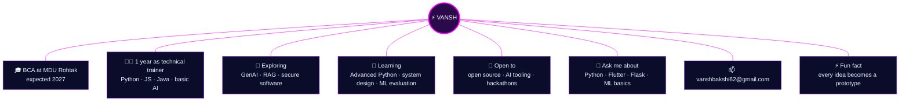

### 🗺️ Me, as a Mind Map

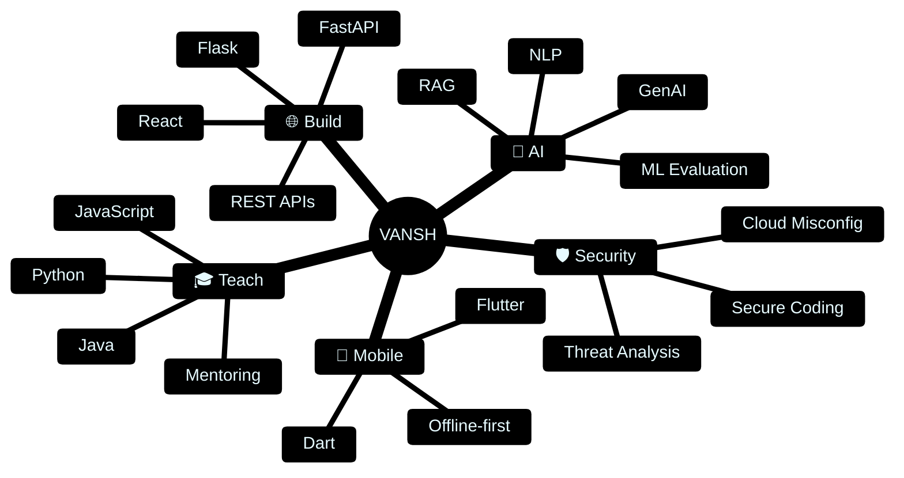

<div align="center"></div>

# 🧬 `02 // BOOT SEQUENCE`

How "Vansh OS" starts every day:

<div align="center"></div>

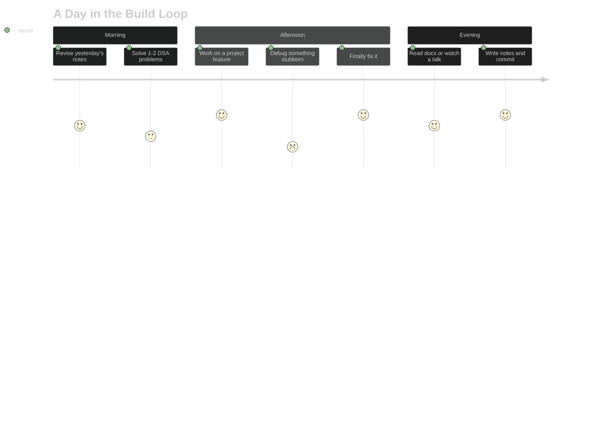

### ⚡ Energy Flow of a Build Day

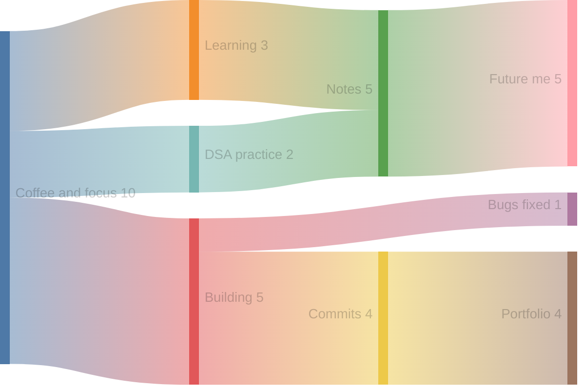

<div align="center"></div>

# 🤖 `03 // THE TECHNOLOGY REACTOR`

<div align="center">

### ⚡ PROGRAMMING LANGUAGES


### 🌐 WEB ENGINEERING


### 📱 APP DEVELOPMENT


### 🧠 AI & DATA


### 🛡️ SECURITY & NETWORKING


### 🛠️ INFRASTRUCTURE


</div>

> **Note:** These icons represent technologies in my learning toolkit. My actual proficiency varies by technology.

### 🌠 The Skill Galaxy

Planets orbit on their own. Color shows how comfortable I am: 🟢 comfortable · 🟡 building · 🔵 exploring. **TODO:** edit `SKILLS` in `assets/generate_assets.py` and re-run it to recolor.

<div align="center"></div>

### 🧱 The Full Stack in One Picture

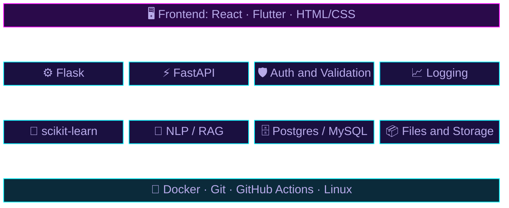

### 🔗 How Skills Feed Projects

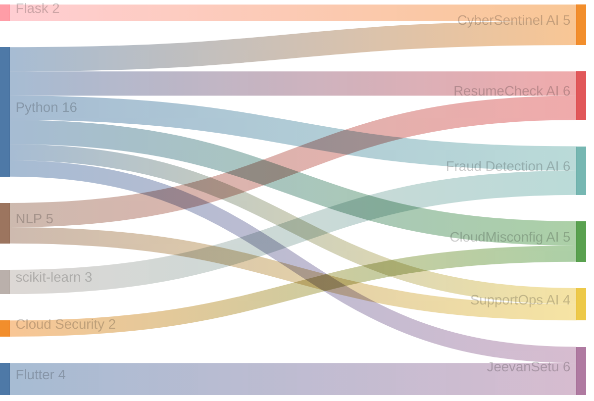

<div align="center"></div>

# 🛸 `04 // PROJECTS FROM THE DIGITAL FRONTIER`

<div align="center">


</div>

### 🌍 My Project Solar System

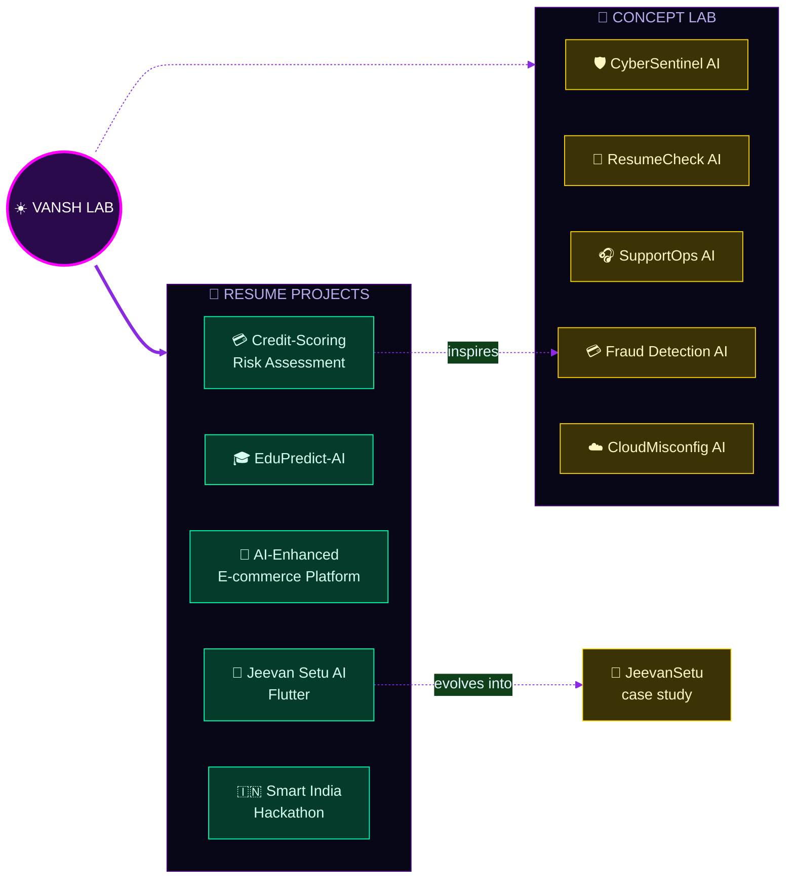

<sub>**TODO:** link each project to its repo. Green = resume projects, yellow = concepts. Move a node to green as you ship it.</sub>

### 🎴 Project Mission Cards

Each card reads **Problem → Idea → Features → Stack → Status**.

#### 🛡️ CyberSentinel AI

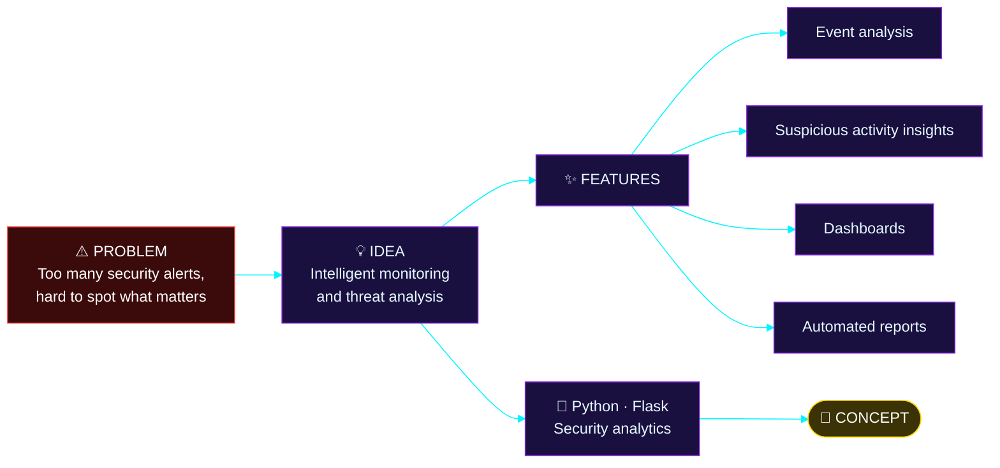

#### 🧠 ResumeCheck AI

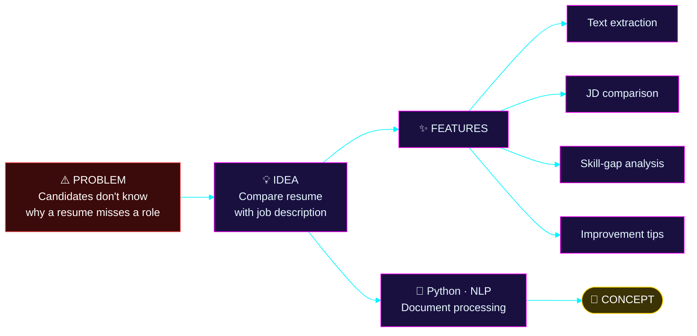

#### 🎧 SupportOps AI

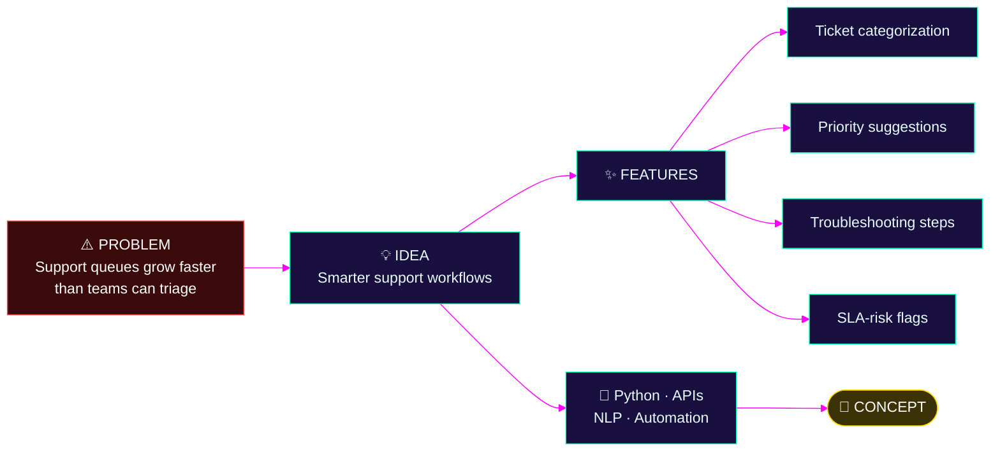

#### 🚨 JeevanSetu

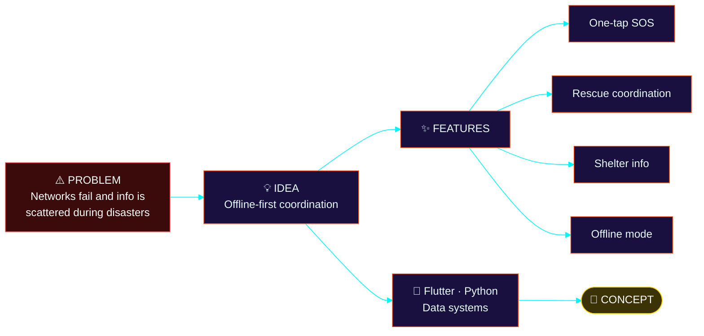

#### 💳 Fraud Detection AI

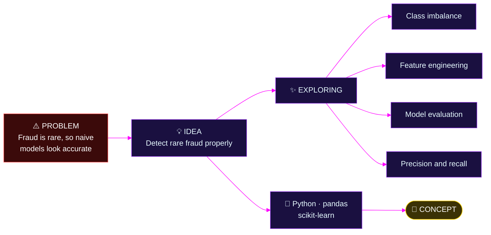

#### ☁️ CloudMisconfig AI

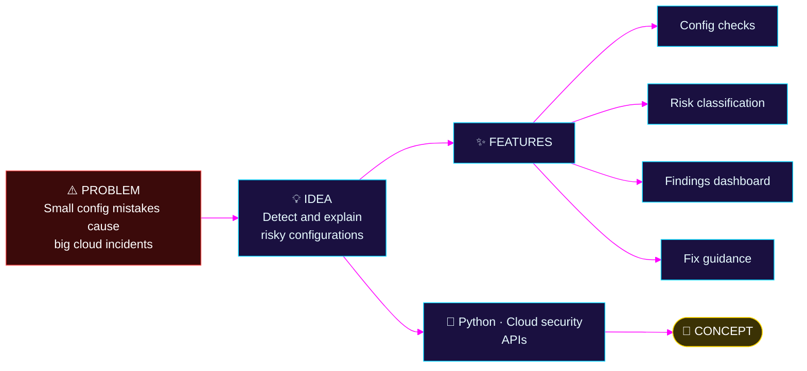

<div align="center">

### ⚠️ PROJECT TRANSPARENCY

Concept cards describe ideas and areas of development, not a claim that every feature is complete. Visit my [repositories](https://github.com/VanshBakshi?tab=repositories) for code, status, and docs.

</div>

### 🧭 Project Portfolio Map

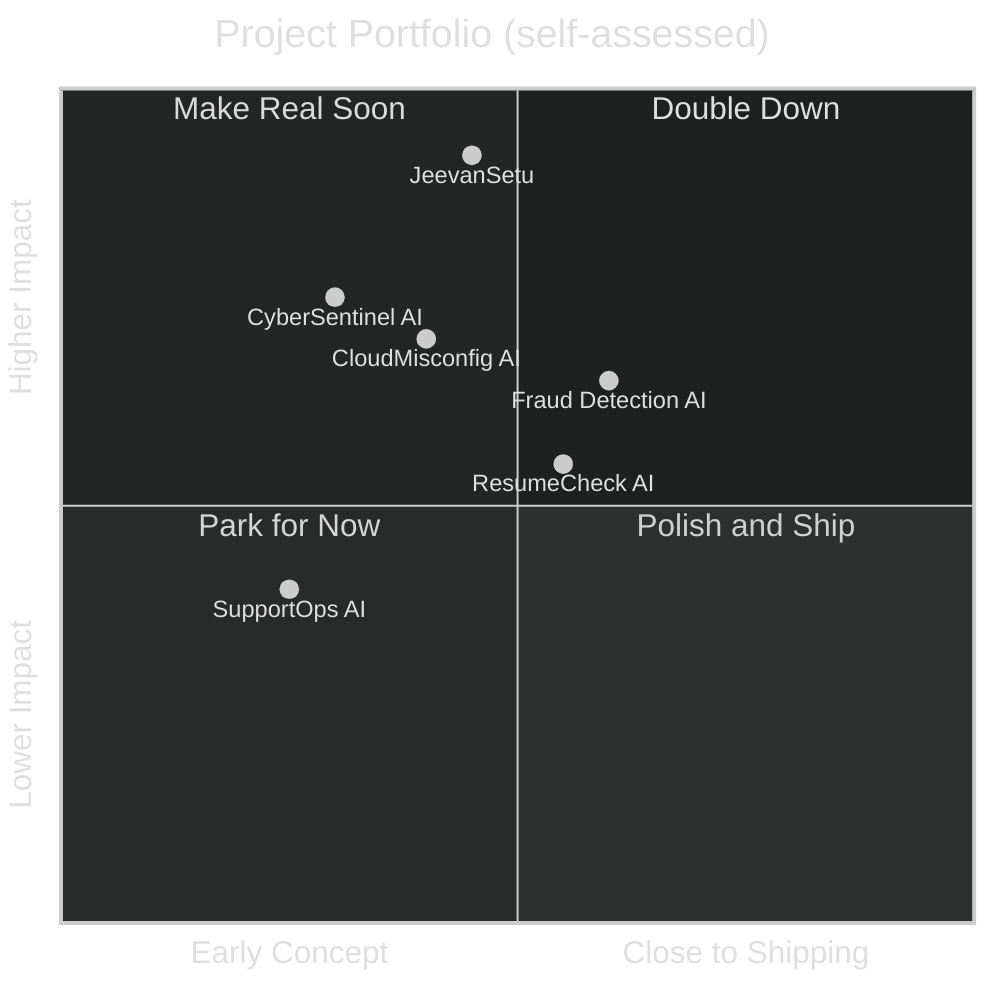

### 🧱 My Definition of "Done"

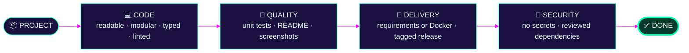

<div align="center"></div>

# 🏛️ `05 // SYSTEM ARCHITECTURE LAB`

### 🌐 End-to-End AI Application

<div align="center"></div>

### 🔄 My Development Lifecycle

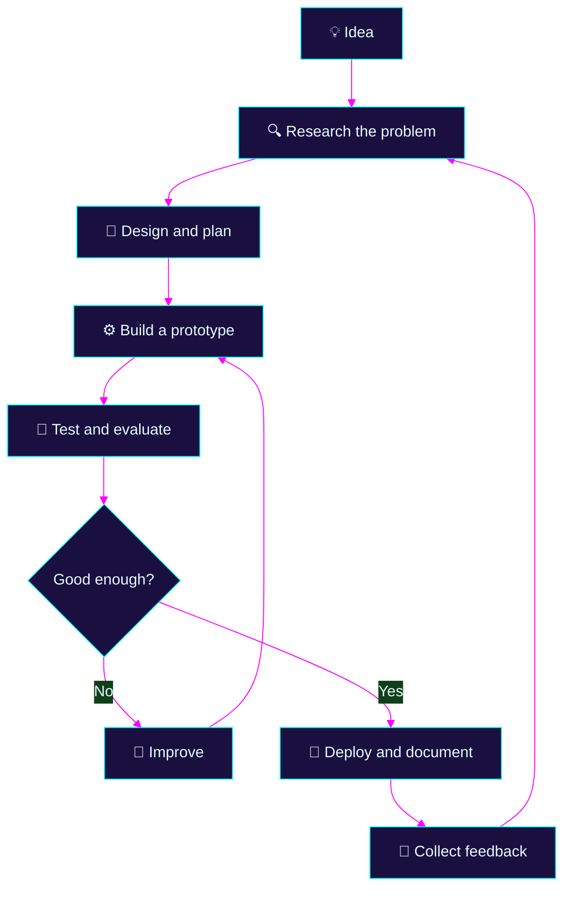

### 🧩 A Request's Journey

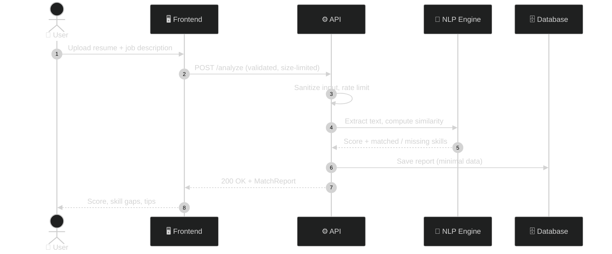

### 🏗️ Class Design: CloudMisconfig AI

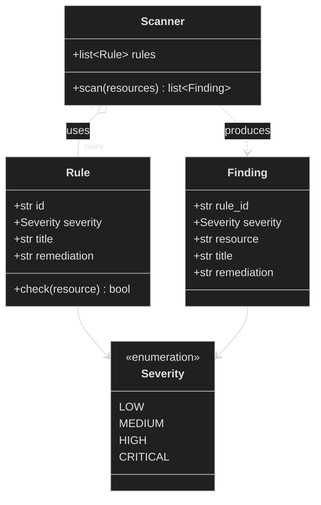

### 🗃️ Data Model: JeevanSetu

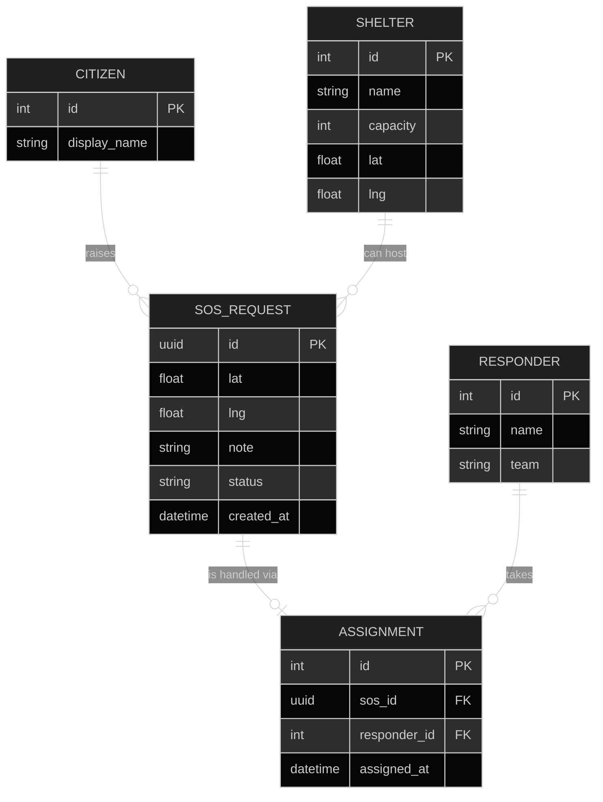

### 🚦 SOS Lifecycle

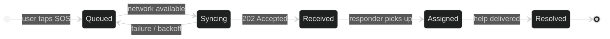

### 🔀 Choosing a Backend (decision tree)

```mermaid
%%{init: {'theme':'base','themeVariables':{'primaryColor':'#1a1040','primaryTextColor':'#e6faff','primaryBorderColor':'#ffd700','lineColor':'#ff00ff'}}}%%
flowchart TD
    Q{"What am I building?"} -->|"Quick prototype / small API"| FL["🌶️ Flask"]
    Q -->|"Typed, async, auto docs"| FA["⚡ FastAPI"]
    Q -->|"Heavy ML or data work"| PY["🐍 Python service + FastAPI"]
    Q -->|"Mobile app backend"| MB{"Need realtime?"}
    MB -->|Yes| FB["🔥 Firebase or WebSockets"]
    MB -->|No| FA
    FL --> DB{"Data shape?"}
    FA --> DB
    PY --> DB
    DB -->|Relational| PG[("🐘 Postgres")]
    DB -->|Flexible documents| MG[("🍃 MongoDB")]
```

<div align="center"></div>

# 🧠 `06 // AI & ML LAB`

### 🔁 Machine-Learning Lifecycle

<div align="center"></div>

### 🔎 RAG Pipeline

```mermaid
%%{init: {'theme':'base','themeVariables':{'primaryColor':'#1a1040','primaryTextColor':'#e6faff','primaryBorderColor':'#ff00ff','lineColor':'#00f5ff'}}}%%
flowchart TB
    subgraph INGEST[" 📚 INGESTION "]
        D1["Documents"] --> D2["Chunk text"] --> D3["Create embeddings"] --> D4[("Vector DB")]
    end
    subgraph QUERY[" 💬 QUERY TIME "]
        Q1["User question"] --> Q2["Embed question"] --> Q3["Similarity search"]
        Q3 --> Q4["Top-k chunks"]
        Q4 --> Q5["Build prompt<br/>question + context"]
        Q5 --> Q6["LLM"] --> Q7["Grounded answer + sources"]
    end
    D4 --> Q3
```

### 💬 NLP Text Pipeline

```mermaid
%%{init: {'theme':'base','themeVariables':{'primaryColor':'#1a1040','primaryTextColor':'#e6faff','primaryBorderColor':'#00ffb3','lineColor':'#ff00ff'}}}%%
flowchart LR
    T["📄 Raw text"] --> N["🧼 Normalize<br/>lowercase · strip noise"]
    N --> K["✂️ Tokenize"]
    K --> S["🚫 Stop-word removal"]
    S --> V["🔢 Vectorize<br/>TF-IDF / embeddings"]
    V --> M{"Task?"}
    M -->|Similarity| SIM["📐 Cosine similarity"]
    M -->|Classification| CLS["🏷️ Classifier"]
    M -->|Generation| GEN["✍️ LLM"]
```

### 🧭 Which Model Should I Try First?

```mermaid
%%{init: {'theme':'base','themeVariables':{'primaryColor':'#1a1040','primaryTextColor':'#e6faff','primaryBorderColor':'#ffd700','lineColor':'#ff00ff'}}}%%
flowchart TD
    S{"Do I have labels?"} -->|Yes| L{"Predict a..."}
    S -->|No| U{"Goal?"}
    L -->|Category| C["🌲 Logistic Regression → Random Forest"]
    L -->|Number| R["📈 Linear Regression → Gradient Boosting"]
    U -->|"Find groups"| KM["🔵 K-Means"]
    U -->|"Spot weird data"| IF["🚩 Isolation Forest"]
    U -->|"Reduce dimensions"| PC["🧊 PCA"]
    C --> E["📏 Always check precision / recall"]
    R --> E2["📏 Always check MAE / RMSE"]
```

### 💳 Why Accuracy Lies

```mermaid
%%{init: {'theme':'dark'}}%%
pie showData
    title Typical Fraud Dataset (illustrative)
    "Legitimate transactions" : 99
    "Fraudulent transactions" : 1
```

> A model that always says "not fraud" scores **99% accuracy** and catches **0%** of fraud. That is why I judge models by precision, recall, and F1.

```mermaid
%%{init: {'theme':'dark'}}%%
flowchart LR
    subgraph CM[" 🧮 CONFUSION MATRIX, AS A FLOW "]
        direction LR
        A["Real fraud"] -->|"model says fraud"| TP["✅ True Positive"]
        A -->|"model says safe"| FN["❌ False Negative<br/>missed fraud"]
        B["Real safe"] -->|"model says fraud"| FP["⚠️ False Positive<br/>annoyed customer"]
        B -->|"model says safe"| TN["✅ True Negative"]
    end
    TP & FP --> PR["Precision = TP / (TP + FP)"]
    TP & FN --> RC["Recall = TP / (TP + FN)"]
    style FN fill:#3b0a0a,stroke:#ff4b4b,color:#fff
    style TP fill:#053b2a,stroke:#00ffb3,color:#fff
    style TN fill:#053b2a,stroke:#00ffb3,color:#fff
```

### 🧠 Example: Minimal ML Evaluation Pipeline

```python
import pandas as pd
from sklearn.ensemble import RandomForestClassifier
from sklearn.metrics import classification_report
from sklearn.model_selection import train_test_split


def evaluate(df: pd.DataFrame, target: str = "is_fraud") -> str:
    """Train a baseline model and report precision/recall per class."""
    X, y = df.drop(columns=[target]), df[target]
    X_train, X_test, y_train, y_test = train_test_split(
        X, y, test_size=0.2, stratify=y, random_state=42
    )
    model = RandomForestClassifier(
        n_estimators=200,
        class_weight="balanced",  # handle class imbalance
        n_jobs=-1,
        random_state=42,
    )
    model.fit(X_train, y_train)
    return classification_report(y_test, model.predict(X_test))
```

<div align="center"></div>

# 🛡️ `07 // SECURITY LAB`

### 🧅 Defense in Depth

<div align="center"></div>

### 🕵️ Threat Modeling Loop (STRIDE-inspired)

```mermaid
%%{init: {'theme':'dark'}}%%
flowchart TD
    A["🎯 Define assets"] --> B["🗺️ Map data flows"]
    B --> C["⚠️ Identify threats"]
    C --> S1["Spoofing"] & S2["Tampering"] & S3["Repudiation"] & S4["Info disclosure"] & S5["Denial of service"] & S6["Privilege escalation"]
    S1 & S2 & S3 & S4 & S5 & S6 --> D["🧮 Rate risk"]
    D --> E["🛠️ Apply mitigations"]
    E --> F["✅ Verify and test"]
    F --> A
```

### 🚨 Incident Response

```mermaid
%%{init: {'theme':'dark'}}%%
flowchart LR
    A["🔔 Alert"] --> B{"Real threat?"}
    B -- No --> C["📝 Tune detection"]
    B -- Yes --> D["🧯 Contain"]
    D --> E["🔍 Investigate"]
    E --> F["🩹 Eradicate and recover"]
    F --> G["📚 Post-mortem"]
    G --> C
```

### ⚔️ Threat vs. Defense Map

```mermaid
%%{init: {'theme':'base','themeVariables':{'primaryColor':'#1a1040','primaryTextColor':'#e6faff','lineColor':'#8a2be2','fontFamily':'monospace'}}}%%
flowchart LR
    T1["💉 SQL injection"] ==> D1["🛡️ Parameterised queries"]
    T2["🪪 Stolen credentials"] ==> D2["🛡️ Hashing + MFA + rate limits"]
    T3["📂 Public bucket"] ==> D3["🛡️ Private by default + scans"]
    T4["🧨 Oversized payloads"] ==> D4["🛡️ Size limits + validation"]
    T5["🔓 Leaked secrets"] ==> D5["🛡️ Env vars + secret scanning"]
    T6["📦 Vulnerable dependency"] ==> D6["🛡️ pip-audit + Dependabot"]
    classDef threat fill:#3b0a0a,stroke:#ff4b4b,color:#fff;
    classDef def fill:#053b2a,stroke:#00ffb3,color:#fff;
    class T1,T2,T3,T4,T5,T6 threat;
    class D1,D2,D3,D4,D5,D6 def;
```

### 🔐 My Security Principles

```mermaid
%%{init: {'theme':'base','themeVariables':{'primaryColor':'#1a1040','primaryTextColor':'#e6faff','primaryBorderColor':'#ff00ff','lineColor':'#00f5ff'}}}%%
mindmap
  root((Secure by Default))
    Least privilege
      Minimal token scopes
      Scoped roles
    Defense in depth
      Validate
      Authenticate
      Authorize
      Log
    Fail securely
      Safe defaults
      Generic client errors
    Never trust input
      Type checks
      Size limits
      Parameterised queries
    Keep it patched
      Pin versions
      Update regularly
```

<div align="center"></div>

# 📊 `08 // DEVELOPER TELEMETRY`

<div align="center">


<br/><br/>


<br/><br/>


<br/><br/>


</div>

<div align="center"></div>

# 🐍 `09 // THE CONTRIBUTION MATRIX`

<div align="center">


**Every contribution is another step forward.**

<sub>This animation needs a GitHub Actions workflow to generate the SVG. See below.</sub>

</div>

<details>
<summary><b>⚙️ Click to see the snake workflow (.github/workflows/snake.yml)</b></summary>

```yaml
name: Generate Snake Animation

on:
  schedule:
    - cron: "0 */12 * * *"   # every 12 hours
  workflow_dispatch:
  push:
    branches: [main]

permissions:
  contents: write

jobs:
  generate:
    runs-on: ubuntu-latest
    steps:
      - uses: Platane/snk/svg-only@v3
        with:
          github_user_name: ${{ github.repository_owner }}
          outputs: |
            dist/github-contribution-grid-snake-dark.svg?palette=github-dark
            dist/github-contribution-grid-snake.svg

      - uses: crazy-max/ghaction-github-pages@v3.1.0
        with:
          target_branch: output
          build_dir: dist
        env:
          GITHUB_TOKEN: ${{ secrets.GITHUB_TOKEN }}
```

</details>

<div align="center"></div>

# 🧪 `10 // THE ENGINEERING MINDSET`

```mermaid
%%{init: {'theme':'base','themeVariables':{'primaryColor':'#1a1040','primaryTextColor':'#e6faff','primaryBorderColor':'#00f5ff','lineColor':'#ff00ff','fontFamily':'monospace'}}}%%
flowchart LR
    A["🔍 ANALYZE<br/>Understand the problem<br/>before choosing the solution"] ==> B["⚙️ ENGINEER<br/>Build · test · improve · document"] ==> C["🚀 EVOLVE<br/>Learn from feedback,<br/>make v2 better"]
    C -.-> A
    style A fill:#2a0a4a,stroke:#ff00ff,color:#fff
    style B fill:#07263b,stroke:#00d4ff,color:#fff
    style C fill:#053b2a,stroke:#00ffb3,color:#fff
```

<div align="center">

```text
┌────────────────────────────────────────────────────┐
│                 VANSH DEVELOPMENT OS               │
├────────────────────────────────────────────────────┤
│  LEARNING       [ ACTIVE ]                         │
│  EXPERIMENTING  [ ACTIVE ]                         │
│  BUILDING       [ ACTIVE ]                         │
│  IMPROVING      [ ALWAYS ]                         │
├────────────────────────────────────────────────────┤
│  PRIMARY DIRECTIVE: SOLVE REAL PROBLEMS            │
└────────────────────────────────────────────────────┘
```

</div>

### 📜 Five Engineering Principles

```mermaid
%%{init: {'theme':'base','themeVariables':{'primaryColor':'#1a1040','primaryTextColor':'#e6faff','primaryBorderColor':'#8a2be2','lineColor':'#00f5ff'}}}%%
flowchart TB
    P(["🧠 PRINCIPLES"])
    P --> A["1️⃣ Clarity over cleverness<br/>code is read more than written"]
    P --> B["2️⃣ Small working increments<br/>a running prototype beats a perfect plan"]
    P --> C["3️⃣ Measure, don't guess<br/>evaluate with data"]
    P --> D["4️⃣ Secure by default<br/>validate · protect secrets · least privilege"]
    P --> E["5️⃣ Document as you go<br/>future me will say thanks"]
```

### 🧭 My Debugging Decision Tree

```mermaid
%%{init: {'theme':'dark'}}%%
flowchart TD
    A["🐞 Something broke"] --> B{"Can I reproduce it?"}
    B -- No --> C["📝 Add logging, gather info"]
    C --> B
    B -- Yes --> D["🔬 Isolate the smallest failing case"]
    D --> E{"Read the error carefully.<br/>Obvious cause?"}
    E -- Yes --> F["🔧 Fix it"]
    E -- No --> G["🧠 Form a hypothesis"]
    G --> H["🧪 Change one thing at a time"]
    H --> I{"Fixed?"}
    I -- No --> G
    I -- Yes --> F
    F --> J["✅ Add a test so it never returns"]
```

### ⚖️ Where My Time Goes (illustrative)

```mermaid
%%{init: {'theme':'dark'}}%%
pie showData
    title Weekly Focus (TODO: adjust)
    "Building projects" : 35
    "Learning new tech" : 25
    "DSA practice" : 15
    "Teaching and mentoring" : 15
    "Documentation" : 10
```

<div align="center"></div>

# 🗺️ `11 // ROADMAP 2026`

<div align="center"></div>


```mermaid
%%{init: {'theme':'dark'}}%%
gantt
    title Vansh Bakshi: 2026 Growth Roadmap
    dateFormat  YYYY-MM-DD
    axisFormat  %b
    section AI / ML
    Strengthen ML fundamentals        :a1, 2026-01-01, 90d
    Build and document an ML project  :a2, after a1, 75d
    section Full Stack
    Polish a Flask/FastAPI project    :b1, 2026-02-01, 90d
    Deploy a full-stack app           :b2, after b1, 60d
    section Mobile
    Flutter offline-first prototype   :c1, 2026-04-01, 100d
    section Security
    Cloud and app security practice   :d1, 2026-05-01, 120d
    section Community
    Open-source contributions         :e1, 2026-03-01, 270d
```

<sub>TODO: adjust dates and goals to your real plan.</sub>

### 🎯 Mission Control

```mermaid
%%{init: {'theme':'base','themeVariables':{'primaryColor':'#1a1040','primaryTextColor':'#e6faff','primaryBorderColor':'#00f5ff','lineColor':'#ff00ff','fontFamily':'monospace'}}}%%
flowchart LR
    G(("🎯 2026")) --> M1["🧠 AI Engineering"] --> O1["Build useful AI/ML apps"]
    G --> M2["🌐 Full Stack"] --> O2["Develop complete web experiences"]
    G --> M3["📱 Mobile"] --> O3["Cross-platform apps"]
    G --> M4["🛡️ Cybersecurity"] --> O4["Security analysis and automation"]
    G --> M5["🧩 Problem Solving"] --> O5["Algorithms and coding skills"]
    G --> M6["🏗️ Real Projects"] --> O6["Ship documented, working software"]
    G --> M7["🤝 Open Source"] --> O7["Learn through contributions"]
    style G fill:#2a0a4a,stroke:#ff00ff,color:#fff,stroke-width:3px
```

### ✅ Checklist

- [x] Create a profile README
- [ ] Ship at least one project end to end with tests and docs
- [ ] Deploy a live demo and link it from the portfolio
- [ ] Make first open-source pull request
- [ ] Publish a technical write-up or blog post
- [ ] Earn a relevant certification *(TODO: choose one)*

<div align="center"></div>

# 📚 `12 // LEARNING LAB`

<div align="center"></div>


### 🌳 What I'm Studying

```mermaid
%%{init: {'theme':'base','themeVariables':{'primaryColor':'#1a1040','primaryTextColor':'#e6faff','primaryBorderColor':'#00f5ff','lineColor':'#ff00ff'}}}%%
mindmap
  root((Learning Lab))
    🐍 Python
      Clean code
      Typing
      Testing
    🧠 ML
      Evaluation
      Imbalance
      Feature engineering
    🌐 Web
      REST design
      Auth
      Deployment
    📱 Mobile
      State management
      Offline storage
    🛡️ Security
      OWASP Top 10
      Cloud misconfiguration
    🧮 DSA
      Arrays
      Trees
      Graphs
      DP
```

```mermaid
%%{init: {'theme':'dark'}}%%
xychart-beta
    title "Learning Progress (self-assessed %, TODO: update)"
    x-axis [Python, ML, Web, Mobile, Security, DSA]
    y-axis "Progress" 0 --> 100
    bar [80, 60, 60, 40, 40, 60]
    line [80, 60, 60, 40, 40, 60]
```

### 🔁 How I Learn Anything New

```mermaid
%%{init: {'theme':'base','themeVariables':{'primaryColor':'#1a1040','primaryTextColor':'#e6faff','primaryBorderColor':'#00ffb3','lineColor':'#ff00ff'}}}%%
flowchart LR
    A["📖 Read the fundamentals"] --> B["🧪 Build a tiny prototype"]
    B --> C["💥 Break it, note what failed"]
    C --> D["📝 Write it down"]
    D --> E["🧑‍🏫 Explain it to someone"]
    E --> F{"Can I explain it simply?"}
    F -- No --> A
    F -- Yes --> G(["🏅 Learned"])
```

### 🧠 Daily Routine Algorithm

```python
def daily_routine(day: int) -> list[str]:
    tasks = ["Solve 1-2 problems", "Read or watch 30 min of something new"]
    if day % 2 == 0:
        tasks.append("Work on a personal project")
    if day % 7 == 0:
        tasks += ["Review the week", "Write notes / documentation"]
    return tasks
```

### 🎯 Current Focus

```mermaid
%%{init: {'theme':'base','themeVariables':{'primaryColor':'#1a1040','primaryTextColor':'#e6faff','primaryBorderColor':'#ff00ff','lineColor':'#00f5ff'}}}%%
flowchart TB
    NOW(("🔭 NOW")) --> A["Turn concepts into working,<br/>documented repositories"]
    NOW --> B["Deepen ML evaluation and RAG skills"]
    NOW --> C["Build a deployable full-stack app"]
    NOW --> D["Practise secure coding habits"]
    NOW --> E["Find open-source projects to join"]
```

<div align="center">


<br/><br/>


</div>

### 🆕 Recently Active Repositories

> Rewritten automatically by a scheduled GitHub Action (see `scripts/update_readme.py`).

<!-- REPOS:START -->
*Auto-generated after the first workflow run*
<!-- REPOS:END -->

<div align="center">


<br/>


</div>

<div align="center"></div>

# 💻 `13 // CODE SHOWCASE`

> **Honest note:** these are *illustrative, self-contained snippets* showing how I approach the problems behind my project ideas. They are not copied from a finished product.

<details open>
<summary><b>🧠 ResumeCheck AI: job-match scoring + skill-gap analysis (Python)</b></summary>

```python
from __future__ import annotations

import re
from dataclasses import dataclass

from sklearn.feature_extraction.text import TfidfVectorizer
from sklearn.metrics.pairwise import cosine_similarity

TOKEN = re.compile(r"[a-zA-Z][a-zA-Z+#.\-]{1,}")


@dataclass(frozen=True)
class MatchReport:
    score: float                 # 0-100
    matched_skills: list[str]
    missing_skills: list[str]


def _tokens(text: str) -> set[str]:
    return {t.lower() for t in TOKEN.findall(text)}


def analyze(resume: str, job_description: str, skills: set[str]) -> MatchReport:
    """TF-IDF similarity plus an explicit skill-gap check."""
    vec = TfidfVectorizer(stop_words="english", ngram_range=(1, 2))
    matrix = vec.fit_transform([resume, job_description])
    similarity = float(cosine_similarity(matrix[0], matrix[1])[0, 0])

    required = _tokens(job_description) & skills
    have = _tokens(resume) & skills

    return MatchReport(
        score=round(similarity * 100, 1),
        matched_skills=sorted(required & have),
        missing_skills=sorted(required - have),
    )
```

</details>

<details>
<summary><b>☁️ CloudMisconfig AI: explainable rule engine (Python)</b></summary>

```python
from __future__ import annotations

from dataclasses import dataclass
from enum import IntEnum
from typing import Callable, Iterable


class Severity(IntEnum):
    LOW = 1
    MEDIUM = 2
    HIGH = 3
    CRITICAL = 4


@dataclass(frozen=True)
class Rule:
    id: str
    severity: Severity
    title: str
    remediation: str
    check: Callable[[dict], bool]    # True => misconfiguration found


@dataclass(frozen=True)
class Finding:
    rule_id: str
    severity: Severity
    resource: str
    title: str
    remediation: str


RULES: tuple[Rule, ...] = (
    Rule("STO-001", Severity.CRITICAL, "Storage bucket is publicly readable",
         "Disable public access and use scoped, signed URLs.",
         lambda r: r.get("type") == "bucket" and r.get("public", False)),
    Rule("STO-002", Severity.HIGH, "Storage encryption at rest is disabled",
         "Enable server-side encryption with a managed key.",
         lambda r: r.get("type") == "bucket" and not r.get("encrypted", True)),
    Rule("NET-001", Severity.HIGH, "SSH open to the entire internet",
         "Restrict port 22 to a trusted CIDR or use a bastion/SSM.",
         lambda r: r.get("type") == "firewall"
         and "0.0.0.0/0" in r.get("ssh_sources", [])),
)


def scan(resources: Iterable[dict]) -> list[Finding]:
    findings = [
        Finding(rule.id, rule.severity, res.get("name", "unknown"),
                rule.title, rule.remediation)
        for res in resources
        for rule in RULES
        if rule.check(res)
    ]
    return sorted(findings, key=lambda f: f.severity, reverse=True)


if __name__ == "__main__":
    demo = [
        {"type": "bucket", "name": "logs-prod", "public": True, "encrypted": False},
        {"type": "firewall", "name": "web-sg", "ssh_sources": ["0.0.0.0/0"]},
    ]
    for f in scan(demo):
        print(f"[{f.severity.name:<8}] {f.rule_id} {f.resource}: {f.title}\n   ↳ {f.remediation}")
```

</details>

<details>
<summary><b>🛡️ CyberSentinel AI: hardened Flask API with validation + rate limiting</b></summary>

```python
from __future__ import annotations

import logging
from collections import Counter

from flask import Flask, jsonify, request
from flask_limiter import Limiter
from flask_limiter.util import get_remote_address

app = Flask(__name__)
app.config["MAX_CONTENT_LENGTH"] = 256 * 1024          # reject oversized bodies
limiter = Limiter(get_remote_address, app=app, default_limits=["60/minute"])
logging.basicConfig(level=logging.INFO, format="%(asctime)s %(levelname)s %(message)s")

ALLOWED_LEVELS = {"info", "warning", "error", "critical"}


def validate(event: object) -> str | None:
    if not isinstance(event, dict):
        return "event must be an object"
    if event.get("level") not in ALLOWED_LEVELS:
        return f"level must be one of {sorted(ALLOWED_LEVELS)}"
    if not isinstance(event.get("source"), str) or not 0 < len(event["source"]) <= 128:
        return "source must be a non-empty string (<=128 chars)"
    return None


@app.post("/api/v1/events")
@limiter.limit("20/minute")
def ingest():
    payload = request.get_json(silent=True)
    events = payload.get("events") if isinstance(payload, dict) else None
    if not isinstance(events, list) or not 0 < len(events) <= 500:
        return jsonify(error="events must be a list of 1-500 items"), 400

    for i, ev in enumerate(events):
        if (err := validate(ev)):
            return jsonify(error=f"events[{i}]: {err}"), 422

    summary = Counter(ev["level"] for ev in events)
    app.logger.info("ingested %d events %s", len(events), dict(summary))
    return jsonify(accepted=len(events), summary=summary), 202


@app.errorhandler(429)
def too_many(_):
    return jsonify(error="rate limit exceeded"), 429


if __name__ == "__main__":
    app.run(debug=False)      # never ship debug=True
```

</details>

<details>
<summary><b>🚨 JeevanSetu: offline-first outbox pattern (Dart / Flutter)</b></summary>

```dart
import 'dart:async';

/// A queued action created while the device may be offline.
class SosRequest {
  SosRequest({required this.id, required this.lat, required this.lng, this.note = ''});
  final String id;           // client-generated UUID => idempotent on the server
  final double lat;
  final double lng;
  final String note;
  int attempts = 0;
}

abstract class OutboxStore {
  Future<void> add(SosRequest r);
  Future<List<SosRequest>> pending();
  Future<void> remove(String id);
}

abstract class SosApi {
  Future<void> send(SosRequest r); // throws on network/server failure
}

/// Persist first, then sync with exponential backoff. Nothing is ever lost.
class SosOutbox {
  SosOutbox(this._store, this._api);
  final OutboxStore _store;
  final SosApi _api;
  bool _draining = false;

  Future<void> submit(SosRequest r) async {
    await _store.add(r);   // 1. durable write
    unawaited(drain());    // 2. best-effort immediate sync
  }

  Future<void> drain() async {
    if (_draining) return;
    _draining = true;
    try {
      for (final r in await _store.pending()) {
        try {
          await _api.send(r);
          await _store.remove(r.id);
        } catch (_) {
          r.attempts++;
          final secs = (1 << r.attempts.clamp(0, 6)); // 1s .. 64s
          await Future<void>.delayed(Duration(seconds: secs));
        }
      }
    } finally {
      _draining = false;
    }
  }
}
```

</details>

<div align="center"></div>

# 🔬 `14 // CASE STUDY: JEEVANSETU`

*A design exercise showing how I break down a hard, real-world problem. Treat it as an architecture plan, not a shipped product.*

### 🎯 Problem → Requirements

```mermaid
%%{init: {'theme':'base','themeVariables':{'primaryColor':'#1a1040','primaryTextColor':'#e6faff','primaryBorderColor':'#ff4500','lineColor':'#00f5ff','fontFamily':'monospace'}}}%%
flowchart LR
    P["🌊 PROBLEM<br/>Floods, quakes, storms:<br/>networks fail exactly when<br/>people need help most"] --> R(["📋 REQUIREMENTS"])
    R --> F["⚙️ Functional<br/>One-tap SOS with location<br/>Shelter directory<br/>Responder dashboard"]
    R --> RL["🔁 Reliability<br/>Works offline<br/>Auto-sync<br/>No duplicate SOS"]
    R --> PF["⚡ Performance<br/>Cold start under 2s<br/>on low-end Android"]
    R --> PV["🔐 Privacy<br/>Minimum data<br/>Location only to responders<br/>Encrypted in transit"]
    R --> OP["🛠️ Operability<br/>Simple deploy<br/>Clear logs<br/>Graceful degradation"]
```

### 🔁 Core Flow

<div align="center"></div>


```mermaid
%%{init: {'theme':'dark'}}%%
sequenceDiagram
    autonumber
    participant P as 📱 Citizen App
    participant O as 🗃️ Local Outbox
    participant A as ⚙️ API Gateway
    participant D as 🗄️ Database
    participant R as 🚒 Responder Dashboard
    P->>O: Save SOS (UUID, GPS, note)
    O-->>P: Confirmed locally ✅
    loop until delivered
        O->>A: POST /sos (idempotent by UUID)
        alt network available
            A->>D: Upsert record
            A-->>O: 202 Accepted
            O->>O: Remove from outbox
        else offline / failure
            O->>O: Exponential backoff
        end
    end
    D-->>R: Live feed of new requests
    R->>A: Mark assigned / resolved
    A-->>P: Status update (push / poll)
```

### 🌐 Deployment View

```mermaid
%%{init: {'theme':'base','themeVariables':{'primaryColor':'#1a1040','primaryTextColor':'#e6faff','primaryBorderColor':'#00f5ff','lineColor':'#ff00ff','clusterBkg':'#0b0b2a','clusterBorder':'#8a2be2'}}}%%
flowchart TB
    subgraph EDGE[" 📱 EDGE (low connectivity) "]
        APP["Flutter App"] <--> LDB[("Local Store")]
    end
    subgraph CLOUD[" ☁️ CLOUD "]
        LB["Load Balancer / HTTPS"] --> API1["API Instance 1"] & API2["API Instance 2"]
        API1 & API2 --> PG[("Postgres")]
    end
    subgraph OPS[" 🚒 RESPONDERS "]
        DASH["Web Dashboard"]
    end
    APP -- "sync when online" --> LB
    PG --> DASH
```

### ⚖️ Key Trade-offs

```mermaid
%%{init: {'theme':'base','themeVariables':{'primaryColor':'#1a1040','primaryTextColor':'#e6faff','lineColor':'#8a2be2','fontFamily':'monospace'}}}%%
flowchart LR
    D1["🔄 Sync model"] ==>|chosen| C1["✅ Outbox + idempotent API"]
    D1 -.->|rejected| A1["Direct calls"]
    C1 --- W1["Survives patchy networks"]

    D2["📱 Client"] ==>|chosen| C2["✅ Flutter"]
    D2 -.->|rejected| A2["Two native apps"]
    C2 --- W2["One codebase, faster iteration"]

    D3["⚙️ Backend"] ==>|chosen| C3["✅ Python (Flask / FastAPI)"]
    D3 -.->|rejected| A3["Node"]
    C3 --- W3["Fits my strengths + data tooling"]

    D4["🗄️ Storage"] ==>|chosen| C4["✅ Postgres"]
    D4 -.->|rejected| A4["NoSQL"]
    C4 --- W4["Relational queries for assignments"]

    D5["🗺️ Maps"] ==>|chosen| C5["✅ Cached tiles"]
    D5 -.->|rejected| A5["Live-only maps"]
    C5 --- W5["Works with no signal"]

    classDef ok fill:#053b2a,stroke:#00ffb3,color:#fff;
    classDef no fill:#3b0a0a,stroke:#ff4b4b,color:#fff;
    class C1,C2,C3,C4,C5 ok;
    class A1,A2,A3,A4,A5 no;
```

### 🧗 Risks → Mitigations

```mermaid
%%{init: {'theme':'base','themeVariables':{'primaryColor':'#1a1040','primaryTextColor':'#e6faff','lineColor':'#00f5ff','fontFamily':'monospace'}}}%%
flowchart LR
    R1["🚫 False or spam SOS"] ==> M1["Rate limiting · verification · responder triage"]
    R2["🔋 Battery drain"] ==> M2["On-demand GPS · batched sync"]
    R3["🕵️ Privacy leaks"] ==> M3["Role-based access · retention limits · audit logs"]
    classDef r fill:#3b0a0a,stroke:#ff4b4b,color:#fff;
    classDef m fill:#053b2a,stroke:#00ffb3,color:#fff;
    class R1,R2,R3 r;
    class M1,M2,M3 m;
```

<div align="center"></div>

# ⚙️ `15 // DEVOPS & QUALITY`

### ✅ Engineering Checklist

- [x] Version control with meaningful commits
- [x] Input validation on every external boundary
- [x] Secrets via environment variables, never committed
- [ ] Automated tests with coverage reporting *(adopting per project)*
- [ ] CI pipeline running lint + tests on every pull request
- [ ] Dependency scanning (Dependabot / `pip-audit`)
- [ ] Container images built from minimal base images

### 🚚 CI/CD Pipeline

```mermaid
%%{init: {'theme':'base','themeVariables':{'primaryColor':'#1a1040','primaryTextColor':'#e6faff','primaryBorderColor':'#00ffb3','lineColor':'#ff00ff'}}}%%
flowchart LR
    A["💻 Push / PR"] --> B["🧹 Lint<br/>ruff"]
    B --> C["🧪 Tests<br/>pytest + coverage"]
    C --> D["🔍 Audit<br/>pip-audit"]
    D --> E["🐳 Build image"]
    E --> F{"main branch?"}
    F -- No --> G["💬 Report on PR"]
    F -- Yes --> H["🚀 Deploy"]
    H --> I["📈 Monitor"]
```

### 🌿 Git Workflow

```mermaid
%%{init: {'theme':'dark'}}%%
gitGraph
    commit id: "init"
    branch develop
    checkout develop
    commit id: "scaffold"
    branch feature/auth
    checkout feature/auth
    commit id: "add login"
    commit id: "tests"
    checkout develop
    merge feature/auth
    branch feature/dashboard
    checkout feature/dashboard
    commit id: "charts"
    checkout develop
    merge feature/dashboard
    checkout main
    merge develop tag: "v1.0.0"
```

### 🔁 Pull Request Life Cycle

```mermaid
%%{init: {'theme':'dark'}}%%
stateDiagram-v2
    direction LR
    [*] --> Draft
    Draft --> InReview: ready
    InReview --> ChangesRequested: feedback
    ChangesRequested --> InReview: fixes pushed
    InReview --> Approved: looks good
    Approved --> Merged: CI green
    Merged --> [*]
```

<details>
<summary><b>🧪 Sample CI file (.github/workflows/ci.yml)</b></summary>

```yaml
name: CI

on:
  push:
    branches: [main, develop]
  pull_request:

jobs:
  test:
    runs-on: ubuntu-latest
    strategy:
      matrix:
        python-version: ["3.10", "3.11", "3.12"]
    steps:
      - uses: actions/checkout@v4
      - uses: actions/setup-python@v5
        with:
          python-version: ${{ matrix.python-version }}
          cache: pip
      - run: pip install -r requirements.txt ruff pytest pytest-cov pip-audit
      - run: ruff check .
      - run: pytest --cov=. --cov-report=term-missing
      - run: pip-audit
```

</details>

<div align="center"></div>

# 📡 `16 // TECH RADAR & GOALS`

<div align="center"></div>


```mermaid
%%{init: {'theme':'dark'}}%%
quadrantChart
    title Tech Radar (self-assessed, TODO: adjust)
    x-axis Exploring --> Comfortable
    y-axis Rarely Used --> Used in Projects
    quadrant-1 Core Toolkit
    quadrant-2 Growing Fast
    quadrant-3 Learning
    quadrant-4 Reliable Basics
    Python: [0.85, 0.92]
    Git: [0.80, 0.80]
    Flask: [0.65, 0.70]
    Flutter: [0.45, 0.75]
    FastAPI: [0.50, 0.60]
    scikit-learn: [0.50, 0.55]
    Docker: [0.40, 0.45]
    React: [0.40, 0.40]
    PyTorch: [0.20, 0.25]
    OpenCV: [0.18, 0.15]
```

### 🎛️ Radar Rings

```mermaid
%%{init: {'theme':'base','themeVariables':{'primaryColor':'#1a1040','primaryTextColor':'#e6faff','lineColor':'#8a2be2','fontFamily':'monospace'}}}%%
flowchart LR
    H["⚪ HOLD<br/>Anything I can't test<br/>or explain yet"] -.-> A["🔵 ASSESS<br/>PyTorch · TensorFlow<br/>OpenCV · Postgres"] ==> T["🟡 TRIAL<br/>Flutter · FastAPI · Docker<br/>scikit-learn · React"] ==> AD["🟢 ADOPT<br/>Python · Git/GitHub<br/>Flask · VS Code"]
    classDef a fill:#053b2a,stroke:#00ffb3,color:#fff;
    classDef t fill:#3b3205,stroke:#ffd700,color:#fff;
    classDef s fill:#07263b,stroke:#00d4ff,color:#fff;
    class AD a; class T t; class A s;
```

### 🏅 Achievement Path

```mermaid
%%{init: {'theme':'base','themeVariables':{'primaryColor':'#1a1040','primaryTextColor':'#e6faff','lineColor':'#ff00ff','fontFamily':'monospace'}}}%%
flowchart LR
    A1["✅ Hackathon<br/>participation<br/>(Smart India Hackathon)"] --> A2["⬜ First open-source PR"] --> A3["⬜ Published<br/>technical article"] --> A4["⬜ Live demo with<br/>real users"] --> A5["⬜ 100+ stars"] --> A6["⬜ Hackathon win"]
    A1 -.-> C1["🎓 Add certification<br/>TODO"]
    style A1 fill:#053b2a,stroke:#00ffb3,color:#fff
    style C1 fill:#3b3205,stroke:#ffd700,color:#fff
```

<div align="center"></div>

# 🏆 `17 // THE LEVEL-UP MAP`

```mermaid
%%{init: {'theme':'dark'}}%%
timeline
    title Journey So Far
    section Foundations
        Learned programming basics : Python, C, Java
        Started Git and GitHub : Version control habits
    section Exploration
        Web and app experiments : Flask, Flutter
        AI and ML experiments : scikit-learn, NLP
        Technical trainer : Taught Python, JavaScript, Java
    section Building
        Smart India Hackathon : Team problem-solving
        Project concepts designed : Security, AI, disaster response
        Profile and portfolio launched : 2026
    section Next
        Ship documented projects : Tests, CI, demos
        Contribute to open source : First merged PRs
```

<sub>TODO: replace entries with your real dates and achievements.</sub>

### 🎮 Game Map: My Developer Levels

```mermaid
%%{init: {'theme':'base','themeVariables':{'primaryColor':'#1a1040','primaryTextColor':'#e6faff','primaryBorderColor':'#00f5ff','lineColor':'#ff00ff','fontFamily':'monospace'}}}%%
flowchart LR
    L1(["🥚 LVL 1<br/>Syntax and basics"]) --> L2(["🐣 LVL 2<br/>Small scripts and CLI tools"])
    L2 --> L3(["🐥 LVL 3<br/>Web apps and APIs"])
    L3 --> L4(["🦅 LVL 4<br/>ML models and evaluation"])
    L4 --> L5(["🐉 LVL 5<br/>Deployed, tested, monitored systems"])
    L5 --> L6(["👑 LVL 6<br/>Open-source and mentoring"])
    YOU{{"📍 YOU ARE HERE<br/>TODO: move me"}} -.-> L4
    style L1 fill:#053b2a,stroke:#00ffb3,color:#fff
    style L2 fill:#053b2a,stroke:#00ffb3,color:#fff
    style L3 fill:#053b2a,stroke:#00ffb3,color:#fff
    style L4 fill:#3b3205,stroke:#ffd700,color:#fff
    style YOU fill:#2a0a4a,stroke:#ff00ff,color:#fff
```

### 💬 Recommendations

> *Add a short quote from a teacher, mentor, teammate, or LinkedIn recommendation here.*
> — **Name, Role**

<div align="center"></div>

# ❓ `18 // FAQ`

<details>
<summary><b>What are you working on right now?</b></summary>
<br/>
Moving my AI, security, and mobile project ideas from concept to documented, runnable repositories.
</details>

<details>
<summary><b>How do you learn new tech?</b></summary>
<br/>
Read the fundamentals, build a tiny prototype, test it, write down what broke, and repeat.
</details>

<details>
<summary><b>What's the best way to contact you?</b></summary>
<br/>
Email is fastest: <a href="mailto:vanshbakshi62@gmail.com">vanshbakshi62@gmail.com</a>. You can also open an issue or follow me on GitHub.
</details>

### 🤝 How Can We Collaborate? (decision tree)

```mermaid
%%{init: {'theme':'base','themeVariables':{'primaryColor':'#1a1040','primaryTextColor':'#e6faff','primaryBorderColor':'#00ffb3','lineColor':'#ff00ff','fontFamily':'monospace'}}}%%
flowchart TD
    S(["👋 You found my profile"]) --> Q{"What are you looking for?"}
    Q -->|"Open-source help"| A["Open an issue or PR<br/>on a repo"]
    Q -->|"Hackathon teammate"| B["Email me with the theme<br/>and timeline"]
    Q -->|"AI / security idea"| C["Share a short problem statement<br/>and let's prototype"]
    Q -->|"Internship / opportunity"| D["Email me or message on LinkedIn"]
    Q -->|"Just saying hi"| E["Star a repo, say hello 🙂"]
    A & B & C & D & E --> Z(["🚀 Let's build"])
```

<div align="center"></div>

# 🌐 `19 // ESTABLISH CONNECTION`

<div align="center">

### 🤝 LET'S BUILD SOMETHING EXTRAORDINARY

Interested in software engineering, AI, open source, or innovative technology?
Let's connect, exchange ideas, and create something useful.

</div>

```mermaid
%%{init: {'theme':'base','themeVariables':{'primaryColor':'#1a1040','primaryTextColor':'#e6faff','primaryBorderColor':'#ff00ff','lineColor':'#00f5ff','fontFamily':'monospace'}}}%%
flowchart LR
    YOU(("🫵 YOU")) ==> HUB{"📡 CONNECT"}
    HUB --> G["🐙 GitHub<br/>VanshBakshi"]
    HUB --> L["💼 LinkedIn<br/>TODO: add handle"]
    HUB --> E["✉️ vanshbakshi62@gmail.com"]
    HUB --> P["🌐 vanshbakshi.github.io"]
    style YOU fill:#2a0a4a,stroke:#ff00ff,color:#fff,stroke-width:3px
    style HUB fill:#07263b,stroke:#00d4ff,color:#fff
```

<div align="center">

<a href="https://github.com/VanshBakshi">

</a>
<!-- TODO: replace YOUR-LINKEDIN-HANDLE with your real LinkedIn profile URL -->
<a href="https://www.linkedin.com/in/YOUR-LINKEDIN-HANDLE">

</a>
<a href="mailto:vanshbakshi62@gmail.com">

</a>
<a href="https://vanshbakshi.github.io/">

</a>

<br/><br/>


<br/><br/>


### `SYSTEM STATUS: THE JOURNEY CONTINUES`

**⚡ V A N S H  B A K S H I ⚡**

*Code with purpose. Think without limits. Build for the future.*

<sub>Designed for the digital frontier · 2026</sub>

</div>
